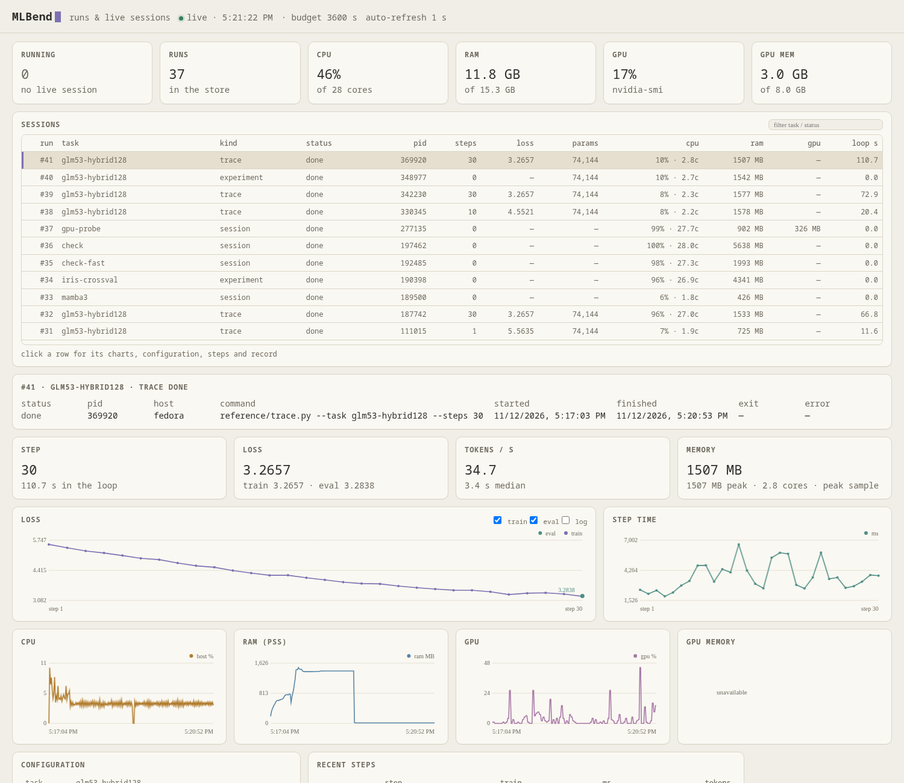

<p align="center">
  
</p>

# bend-lab

**Machine learning, built in Bend.** Models are written from scratch in
[Bend](https://github.com/bendlang/bend) and trained on
[BendTorch](https://github.com/nuxyel/BendTorch). The repository is an
experiment corpus, not a library. bend-ml owns the tensors and the laws,
BendTorch owns the training, and this repository uses them, measures them and
records the results.

Every number comes from a program in the repository and is checked three ways:
against a NumPy twin written at the same operation order, against an outside
implementation where one exists (scikit-learn, PyTorch, the lucidrains UNet),
and against an earlier version of itself through frozen probes. When the three
disagree, the disagreement is the result. A number that was not measured is not
written down.

<p align="center">
  <a href="https://github.com/adeerkhan/bend-lab/actions/workflows/ci.yml"></a>
</p>

## Results


The diffusion track is complete through a ViT denoiser: 2×2 patches, 16 tokens,
three pre-LN blocks, 100,736 parameters and 3000 steps on the first 1024
optdigits images. Legibility is the mean best absolute correlation of a sample
with any training digit. Random images score 0.326, the digits MLP scores 0.408,
and the gate is 0.75.

| arm (same data, sampler and starting noise) | DDIM 16 | ancestral 64 | DDIM MSE | ancestral MSE |
|---|---:|---:|---:|---:|
| **Bend-ViT** | **0.787** | **0.811** | 0.0598 | 0.0561 |
| PyTorch, same architecture | 0.790 | 0.779 | 0.0583 | 0.0633 |
| lucidrains UNet (reference) | 0.932 | 0.940 | 0.0202 | 0.0183 |

The Bend model is within 0.003 of the PyTorch twin on DDIM and ahead of it on
the ancestral sampler, with the same 4096 starting samples. Its cloud mean and
standard deviation are 0.2957 / 0.3395 against the data's 0.3076 / 0.3767, and
4087 of 4096 pixels land in [0, 1].

The gap closed in the training loop, not in the architecture. Bend drew one
timestep per batch while the reference generated samples one per image, worth +0.36
legibility. The evidence is in `results/diffusion-vit/`, and the three-arm
comparison is `results/compare/index.html`.

## Diffusion


The loss falls from 1.009 to 0.071 over 3000 steps, with a minimum of 0.058.
The frozen probe pins the forward pass, one ancestral step, the 16-step DDIM
cloud and the eta=0 invariance to the NumPy twin; the legibility gate is 0.75.
The same task also runs on a dense MLP over real digits, and on two moons with
an ancestral sampler and DDIM.


## Flow matching


Rectified flow replaces the diffusion chain with one vector field and an Euler
ODE: `x_t = noise*(1-t) + data*t`, target `v = data - noise`, MSE loss, and a
sample integrated over 32 steps of `linspace(0, 1)`. The 2D example uses three
linear layers with SiLU, full batch, 6000 AdamW steps, and reaches a last-100
loss of 0.886. Its samples have mean 0.049 / -0.048 and standard deviation
0.610 / 0.675 against the data's 0.000 / 0.000 and 0.577 / 0.659, with 112 of
128 inside the data's box. A frozen probe and NumPy twin for this example are
still to be added.

## Running on your machine

A Bend program's shapes are type-level constants, so the model is chosen before
the compile. Two commands make that choice explicit instead of accidental:

```
make doctor                 # RAM, cores, GPU, the build budget, the preset that fits
make flow64 PRESET=tiny    # build and run the 64x64 flow inside that budget
```

`make doctor` reads the machine and prints a build budget (55% of RAM, capped at
12 GB). Every build runs under `scripts/bend-guard.sh`, which puts it in a memory
cgroup with swap off: a compile that grows past `BEND_MEM` (default 6 GB) is
killed with a message, and the desktop stays up. That guard exists because it
did not, twice: `bend -o` on the 64x64 flow reached 9.3 GB and took the session
into swap with it. The measured costs and the bisect are in `docs/NOTES.md`.

The preset is a property of the program, not a runtime flag:

| preset | images/step | width | rows | compile memory |
|---|---|---|---|---|
| `tiny` | 1 | 64 | 64 | over 7.5 GB, not yet buildable |
| `small` | 1 | 96 | 64 | not measured |
| `medium` | 2 | 128 | 128 | not measured |
| `full` | 8 | 128 | 512 | past 8 GB, killed |

None of them builds on a 15 GB machine yet. The cost is not the model's size:
a one-block, 64-wide model costs more to compile than the 512-row three-block
one did before the file was split, which points at the number of large recursive
functions in one program rather than at the dimensions. The ViT example, the
same architecture at 512 rows, does build in 82 s under 8 GB, so the target is
reachable; splitting training and sampling into two programs is the next
experiment. Nothing here is hidden behind a default that silently OOMs.


## Layout

```
examples/          what is run: one directory per task, with main.bend, README.md and plot.svg
  classification/    knn, logistic, mlp, naive_bayes, naive_bayes_heart, crossval
  diffusion/         two_moons, flow_matching, digits, vit
  transformers/      attention, periodic
  unsupervised/      kmeans, pca
{metrics,hf,datasets,preprocess,split,select,cluster,pipeline,report,generative}/
                   the ten packages published to BendHub
reference/         what proves it: twins, probes, gates, comparisons, the task registry
results/           what it proved: run.json, REPORT.md, plots, the three-arm comparison
docs/              PLAN, AUDIT, NOTES, the agent handoff, assets/ (hero and figures)
papers/            paper comparisons: the claim, the reduced protocol, the two arms
bench/             compute-only benchmarks
```

The rule for the tree: the package directories are what gets published,
`examples/` is what runs, `reference/` is what proves it, and `results/` is what
it proved. Moving the packages under `packages/` and the verification layer
under `apparatus/` is the next structural step. Those moves touch `bend.toml`
and many paths, so they go in one commit with `make check` behind them.

## Quickstart

Bend 2.0.38, Lean 4.34.0, clang and the Python environment, one command:

```sh
make setup                                               # toolchain, lock, environment
bendenv run -- bend examples/diffusion/vit/main.bend     # train and sample the ViT
make check                                               # the gate: proofs, kernels, twins, comparisons
make trace TASK=glm53-hybrid128 STEPS=20                 # one JSON line per step, written as it runs
make dash TASK=glm53-hybrid128                           # terminal: loss, step time, tokens/s, the stage split
make dash TASK=glm53-hybrid128 WATCH=1                   # follow a run while it writes
make dashboard PORT=8787                                 # every run, CPU/RAM/GPU, live sessions
./scripts/dashboard.sh start                             # the same page in the background
make session TASK=check-fast CMD="make check-fast"        # any test as a dashboard session
```

## The dashboard



`make dashboard PORT=8787` (or `./scripts/dashboard.sh start` for a background
server) serves the in-house W&B view at `http://127.0.0.1:8787/`: every run in
`scripts/batch.sh` (or `make batch`) runs the full matrix through the same
sessions and writes one summary, `results/batch-<date>.md`.

`results/runs.sqlite3`, live sessions, host CPU, RAM, GPU utilization and GPU
memory, each run's parameter count and configuration, and the selected run's
train and eval loss, step time, extra signals, system samples, steps and
record. A run's CPU is its **share of the host** with the core count beside
it; RAM is **PSS** over the process tree, so shared libraries are counted
once; GPU usage comes from `nvidia-smi`. The loss panel has `train`, `eval`
and `log` toggles; `?run=ID` opens a run directly.

The page follows the Bend cream, charcoal and purple identity. The sun/moon
button in the header switches between light and dark; the choice is saved in
the browser. `?theme=dark` (or `?theme=light`) is a shareable override.

Training runs register through `make trace` (the GLM trace now also records the
final test `val_loss`), tests through `make session TASK=... CMD="..."`,
and `make experiment` registers itself. A run that is not in the store is not
in the page.

`make check` is the gate. It checks the proofs and the kernel with Lean, runs
the programs that must be refused, and compares every measured number with a
NumPy or scikit-learn reference. On a cold machine it builds each program once,
which is the slow part.

`make trace` runs a task's program in trace mode and streams one JSON line per
step to `results/<task>/trace.jsonl`; `make dash` reads it and prints the live
page, with the task's record underneath. Neither decides pass or fail, and the
trace is standard library only: no library support is needed to time our runs.

## The corpus

| example | data | what is checked | result |
|---|---|---|---|
| `diffusion/vit` | optdigits, 1024 × 8×8 | legibility of 4096 samples, three arms | **0.787 / 0.811** (torch 0.790 / 0.779) |
| `diffusion/digits` | optdigits, 1024 × 8×8 | first loss against the twin, cloud statistics | 1.0039 (twin agrees to 2.9e-8) |
| `cifar` | cifar10, 256 × 32×32×3 | first loss and data mean against the twin | 1.0014 (twin agrees to 2.5e-5) |
| `diffusion/two_moons` | two moons, 128 × 2 | loss curve, cloud mean and std | 152.95 → 0.065 |
| `diffusion/flow_matching` | two moons, 128 × 2 | last-100 loss, sample mean/std, box | 0.886, 112/128 in the box |
| `transformers/periodic` | periodic 0…7, 32 × 8 | loss and next-token accuracy | 2.359 → 0.002, accuracy 1.00 |
| `transformers/attention` | synthetic 4 × 8 | every output against NumPy | checksum 1.76295, delta 3.3e-9 |
| `language/mamba_vit` | MNIST, 160 × 28×28, seed 0 | five training steps against the float64 twin | loss and clipped gradient norm per step at 1e-3, final weights (108 sums of squares) at 1e-3 |
| `language/mamba3-tiny-lm` | byte corpus, 20 train examples × 128 positions, seed 101/102/20261115, 20 steps | AdamW vs the float32 twin | loss per step at 1e-3, weights at 1e-3, test bits/byte 6.2476 == 6.2476, accuracy 0.3147 == 0.3147 |
| `classification/crossval` | iris, 150 × 4 | five stratified folds, no leakage | 0.9307 ± 0.006 (sklearn 0.9307) |
| `classification/knn` | breast cancer, 683 × 9 | accuracy on the same split | 0.978102 (sklearn 0.978102) |
| `classification/naive_bayes` | breast cancer, 683 × 9 | accuracy on the same split | 0.985401 (sklearn 0.985401) |
| `classification/naive_bayes_heart` | heart failure, 299 × 12 | accuracy on the same split | 0.950000 (sklearn 0.950000) |
| `classification/mlp` | iris, 150 × 4 | accuracy, 400 SGD steps | 0.973333 (sklearn 0.973333) |
| `classification/logistic` | iris, 150 × 4 | the loss over four steps | 1.0986 → 1.0672 |
| `unsupervised/kmeans` | wine, 6497 × 11 | inertia and cluster sizes | 50645.64, [2384, 990, 3123] |
| `unsupervised/pca` | wine, 6497 × 11 | explained variance ratio | 0.275443 (sklearn 0.275443) |

`make results` writes the full table, with the delta and tolerance of every
task, to `results/RESULTS.md`. The dataset, seed, hub hashes and git state of
each run are in `results/latest/`.

## Method

1. An example in `examples/<area>/<task>/main.bend` trains and prints its
   numbers.
2. A twin in `reference/` mirrors it in NumPy at the same operation order.
3. A gate in `reference/test_<task>.py` compares the two and runs in
   `make check`.
4. A result in `results/<task>/` records the run, the report card and the plots.

A number that was not measured does not go in a README, a report card or a
result.

Run one task, or the whole corpus, through the experiment layer:

```sh
reference/.venv/bin/python reference/experiment.py --list
reference/.venv/bin/python reference/experiment.py --task iris-crossval
```

Each run writes a report card and a manifest: the git commit, the Bend version,
every package at its hub hash, the machine, the seed and the tolerances. The
README figures are generated from those result files with `make figures`.

## The GPU lane

`bend.toml` pins `bendtorch@2.1.0.0`, `bendtorch-gpu@2.1.0.0`,
`bend-ml-tensor-array@0.1.20.0` and `bend-ml-tensor-gpu@0.1.5.2` (the array
and GPU versions BendTorch 2.1.0.0 itself imports). The ViT builds
with eight `LinearNBF` and one `F.Attention`, links `libnvrtc`, and executes on
an RTX 5060. `nvidia-smi` shows the process with 104 MiB on the card, and the
frozen values are bit-identical to the CPU lane.

The earlier 5m44 either way was measured against the data path, not the device.
After the builder fix the step is 131 ms and 95% of it is forward and backward,
so the device lane is worth re-measuring. The split is in
`results/PLUMBING.md`.

## Papers

Paper comparisons live in `papers/`, one folder per paper, with the paper's
claims, the reduced protocol used here, and the Python and Bend arms. The first
entry, TEM, is a negative result: the 64x64 contrastive protocol collapses to a
constant energy, the denoising variants move toward the data but need far more
compute, and the Bend port is blocked by the missing full attention, RoPE and
adaLN. Paper numbers are never presented as reproduced.

## Denoiser comparison: ViT, JiT(DiT), HiT, Dimba-style hybrid

Four small denoisers were trained on the pinned flowers64 split under one
protocol: 2,048 training images, 102 test, 64x64 grayscale, patch 8 (64
tokens), 1,200 steps at batch 16, seed 0, the same clean-image velocity loss
and the same 32-step sampler. Every number below comes from a committed
`run.json`; `results/dimba/one_page.png` is the single-page chart.

| arm | params | test-set legibility | final loss | source |
|---|---:|---:|---:|---|
| ViT, plain blocks | 4.74M | 0.514 | 0.074 | `reference/hit_v4.py`, `results/hit-v4/vit/` |
| JiT / DiT, adaLN + context | 6.53M | 0.607 | 0.070 | `reference/hit_v4.py`, `results/hit-v4/jit/` |
| HiT, two learned grouping levels | 6.62M | 0.573 | 0.120 | `reference/hit_v4.py`, `results/hit-v4/hit/` |
| Dimba-style Transformer-Mamba hybrid | 7.57M | **0.622** | 0.075 | `reference/dimba_ref.py`, `results/dimba/hybrid/` |

The hybrid result is attributable to its Mamba blocks: the same code with
`mamba_ratio=0` scores 0.6071 with exactly the JiT parameter count
(`results/dimba/ablation-no-mamba/`). HiT's earlier lower numbers were traced
to missing architecture pieces and a NaN in the budget loss; the corrected
v4 model is 0.573, still below JiT/DiT at this scale. The hybrid costs 1,705 s
against about 500 s for the others because its Mamba scan is a Python loop.

**These are CPU torch reference implementations in `reference/`, not Bendlang
models.** No Bend port exists for any of the four. BendTorch now has
`FullAttention` and the adaLN composition, but no Mamba/SSM layer, and
bendlang#2146/#2147 affect the router records and the recursive hierarchy;
`AGENTS.md` and the upstream section below carry the details. All four exceed
the 0.536 real-flower positive control on legibility, a metric smooth blobs can game,
so the ranking is relative evidence, not a claim of image quality or FID.

### Terminology

These runs use the standard machine-learning split: a **training set** of
2,048 flowers and a **test set** of 102 flowers never seen during training.
The reported legibility is an **evaluation metric** on the test set; the
random-noise **negative control** is 0.053 and a real flower's **positive
control** is 0.536. Higher test-set legibility with lower training-set
legibility would indicate **generalization**; the reverse indicates
**overfitting**. One caveat, stated plainly: the same 102 flowers were used
while choosing configurations, so under strict ML definitions they are a
**validation set** and no unbiased test-set estimate has been measured. A
fresh, untouched test set is needed before calling any number a final test
score.

## Upstream

Everything this repository found in Bend, filed at
[bendlang/bend](https://github.com/bendlang/bend), and what came back. Every
issue carries the program that found it; every pull request was tested against
the programs in `examples/` and `reference/` here.

**Open — filed from here**

| Issue | What it found |
|---|---|
| [#2150](https://github.com/bendlang/bend/issues/2150) | No sanctioned encoding for evolving state across an online loop; the Mamba-3 work unrolled it by hand. |
| [#2147](https://github.com/bendlang/bend/issues/2147) | No forward references or mutual recursion. Re-confirmed on 2.0.38 with `mutual.bend` ("an unfilled law is a dead claim"); commented with the HiT recursive-hierarchy case. |
| [#2146](https://github.com/bendlang/bend/issues/2146) | No record field projection, no match on a local binder, no Data-shared records. Re-confirmed all three on 2.0.38; commented with the HiT router-record case. |

Filed from here: [bend-ml#41](https://github.com/nuxyel/bend-ml/issues/41) asks
`tensor-array` for a masked scatter-add / segment-mean primitive with forward
and backward laws. It is a convenience-and-law request, not a blocker: the
reduction is expressible today by hand in the Mamba-3 embedding gradient, the
rectified-flow max-pool backward, and the HiT CPU reference. It carries no
public measurement.

**Open elsewhere, relevant to the HiT/DiT port (not filed from here)**

[#1991](https://github.com/bendlang/bend/issues/1991) `Array.to_list` copies both halves per level (~190 instructions/cell); [#2182](https://github.com/bendlang/bend/issues/2182) `@unsafe` closure reused twice fail-stops on the native lane; [#2038](https://github.com/bendlang/bend/issues/2038) compiler memory at large application scale; [#1623](https://github.com/bendlang/bend/issues/1623) verdict rejects a reused proof with a function field. BendTorch: [#43](https://github.com/nuxyel/BendTorch/issues/43) TTS layers and [#29](https://github.com/nuxyel/BendTorch/issues/29) the Conv2d adjoint law. The old causal-only `Attention` and missing-adaLN blockers for a Bendlang DiT are **resolved**: `FullAttention` is in BendTorch (#20) and the per-image row-wise modulation is built as a `Tile`/`Fork`/`Both`/`Mul2`/`Add2` composition (#19, `demo/adaln_probe.bend`). What remains for a Bendlang **HiT** is a grouped/segmented reduction primitive (masked scatter-add, affinity average linkage, masked group-mean read and the reverse scatter for gradients) — filed as bend-ml#41; the hybrid additionally needs a Mamba/SSM selective-scan layer. CPU reference arms are in `reference/`.

**Closed**

| Issue | Outcome |
|---|---|
| [#2059](https://github.com/bendlang/bend/issues/2059) | Base states no bit facts about `U32` (mask, halving, the branch bit, the subtraction bound). Closed as completed: [#2213](https://github.com/bendlang/bend/pull/2213) merged `tests/proof/array_perfect_tree.bend`, proving the four facts and `Array.get`/`set` on perfect trees of Nat, all under `--verdict`. The laws live in `tests/proof`, not `Base`; whether Base should own Array laws stays open in [#1934](https://github.com/bendlang/bend/issues/1934). |
| [#1980](https://github.com/bendlang/bend/issues/1980) | `Array<T>` accepts a mixed-depth `ANode` the compiled runtime cannot represent. Closed as a duplicate. |
| [#1962](https://github.com/bendlang/bend/issues/1962) | `Array.new`'s depth argument was undocumented, and a length gave "an array past the deepest block class 31". Fixed by [#1963](https://github.com/bendlang/bend/pull/1963) and [#1970](https://github.com/bendlang/bend/pull/1970). |
| [#1961](https://github.com/bendlang/bend/issues/1961) | `import` refused a path segment starting with a digit while the error said digits are allowed. Fixed by [#1964](https://github.com/bendlang/bend/pull/1964). |
| [#1894](https://github.com/bendlang/bend/issues/1894) | The run path overflows its stack on a 32k-element list while `--check-only` and `-o` are fine. Fixed by [#1921](https://github.com/bendlang/bend/pull/1921). |
| [#1868](https://github.com/bendlang/bend/issues/1868) | A pure let inside a do block was refused with a message pointing at the previous statement. Fixed by [#1889](https://github.com/bendlang/bend/pull/1889), after [#1870](https://github.com/bendlang/bend/pull/1870). |
| [#1863](https://github.com/bendlang/bend/issues/1863) | The GPU build recipe existed only in a comment in `cli_build`. Fixed by [#1888](https://github.com/bendlang/bend/pull/1888), after [#1871](https://github.com/bendlang/bend/pull/1871). |
| [#1848](https://github.com/bendlang/bend/issues/1848) | The two spellings of an effect (`IO<Unit>` and `IO(Unit)`) both named the wrong side. Closed; [#1835](https://github.com/bendlang/bend/pull/1835) was the attempt. |
| [#1789](https://github.com/bendlang/bend/issues/1789) | Base could not read a number from a string. Fixed in Base. |
| [#1716](https://github.com/bendlang/bend/issues/1716) | A bare constructor name as a match pattern silently became a catch-all when the datatype was imported. Fixed by [#1738](https://github.com/bendlang/bend/pull/1738), after [#1717](https://github.com/bendlang/bend/pull/1717). |

**Pull requests opened from here**

Open, awaiting maintainer review: [bend-ml#40](https://github.com/nuxyel/bend-ml/pull/40) the one-cell `to_list`/`from_list` round trip; [#39](https://github.com/nuxyel/bend-ml/pull/39) `Array.get` returns the array it read; [#38](https://github.com/nuxyel/bend-ml/pull/38) the `Array.get.go` law (opened from this work and still under review). All three pass `--check-only` and `--verdict`, with green CI and no reviews as of 2026-11-22. [BendTorch#45](https://github.com/nuxyel/BendTorch/pull/45) (tryingET's general Conv1d) was reviewed and approved from here; it was not opened by us.

Merged: [#1880](https://github.com/bendlang/bend/pull/1880) `Array.get_unchecked`, an `@unsafe` read without the
wrap mask; [#1845](https://github.com/bendlang/bend/pull/1845) `File.read` fills its buffer instead of answering one
`read(2)`; [#1748](https://github.com/bendlang/bend/pull/1748) the gate counts caps with one tokenizer;
[#1655](https://github.com/bendlang/bend/pull/1655) an async-signal-safe SIGSEGV/SIGBUS trap;
[#1654](https://github.com/bendlang/bend/pull/1654) the bug form asks for `bend version`;
[#1653](https://github.com/bendlang/bend/pull/1653) effects scan with the source's own comment rules.

Closed with the maintainer's own fix landing instead: [#1820](https://github.com/bendlang/bend/pull/1820) the native
spin's poll period, [#1769](https://github.com/bendlang/bend/pull/1769) the gate pin's columns,
[#1715](https://github.com/bendlang/bend/pull/1715) native C intrinsics for `Nat.pow`, `U32.log2` and `Map.msb.u`,
[#1652](https://github.com/bendlang/bend/pull/1652) and [#1651](https://github.com/bendlang/bend/pull/1651) the JS
lane, and the seven diagnostic prototypes
[#1731](https://github.com/bendlang/bend/pull/1731)–[#1737](https://github.com/bendlang/bend/pull/1737) for
[#1632](https://github.com/bendlang/bend/issues/1632).

## Status

`make check-fast` is 33/33. A recorded full-gate log shows 155 ok with 0
failures; coverage across runs is documented in `docs/agents/handoff.md`, but
no single uninterrupted green run of the full gate over the latest commits is
claimed.

Each track keeps its own record under `results/`: the diffusion ViT, flow
matching, CIFAR-10, the flowers U-Net, rectified flow, Mamba-3, MambaViT and
the GLM stages. `make validate` runs the environment check, the cheap gate,
the full gate and the smoke. `make report TASK=<task>` prints a task's latest
record and `make trace` / `make dash` render a run's steps live.

The four-arm flowers denoiser comparison (ViT, JiT/DiT, HiT, Dimba-style
hybrid) and the Bendlang DiT block are described in their own sections above;
their measurements live in `results/hit-v4/`, `results/dimba/` and
`results/dit/`.

## Licence

MIT. See `LICENSE`.
