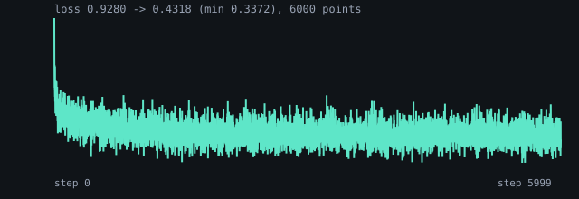
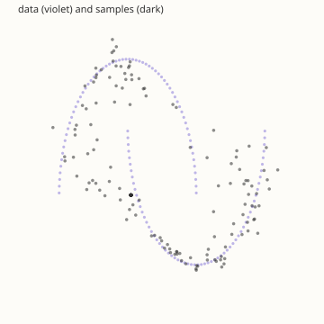

# Rectified flow on two moons

Flow matching replaces the diffusion chain with one vector field and an ODE:

    forward   x_t = noise*(1-t) + data*t      (t = 0 noise, t = 1 data)
    target    v   = data - noise
    loss      MSE(v_theta(x_t, t), v)
    sample    x <- x + v_theta(x, t)*dt,  Euler over linspace(0, 1, steps+1)

There is no beta schedule, no posterior, no sigma and no eta. The level of each
point comes from a U32 Weyl sequence, one level per point. The model is three
linear layers with SiLU (2 inputs for x_t, 1 for t, width 128), trained
full-batch for 6000 steps with AdamW at 3e-3.

```console
$ bendenv run -- bend examples/diffusion/flow_matching/main.bend
$ make flow          # the same, then results/flow-matching/
```

## What it measures

The data is the DDPM example's two moons, normalised to [-1, 1] on both axes.
The sample is 32 Euler steps from `noise_of(2000000)`.

| | value |
|---|---|
| first loss | 1.4768 |
| final loss | 0.8360 |
| last 100 mean | **0.8859** |
| data mean / std | 0.000 / 0.000 · 0.577 / 0.659 |
| sample mean / std | +0.049 / -0.048 · 0.610 / 0.675 |
| inside the data's box | 112/128 |

The NumPy probe (`reference/flow_probe.py`) measured loss 2.1253 -> 0.8662,
samples mean [-0.111, 0.150] / std [0.546, 0.745] against its data's
[-0.002, -0.000] / [0.583, 0.741], and 465/512 inside the box. This example
runs the same method on the repository's own 128-point data, so its means and
box count are compared with that data. The loss scale differs because the
probe's data has 4096 points and a different init draw.





The element-by-element gate is `reference/test_flow2d.py` (2026-11-05):
`reference/probe_flow2d.bend` prints the model's own `Layer.dump`, the input rows, one
forward step at t = 0.5, one Euler step at t = 0 and the 8/16/32-step states, and
`reference/twin_flow2d.py` rebuilds all of them from that dump. Six gates, each under
`4e-7` against a `1e-5` tolerance; `reference/check_all.py` runs it with the rest.

## Checkpoints

`main.bend` takes `--steps N`, `--start N`, `--save PATH`, `--resume PATH` and
`--no-sample`. `--save` writes the training state with `Train.save` — the
parameters, Adam's first and second moments, then `1 - b1^t` and `1 - b2^t` —
and `--resume` reads it back with `Train.restore`. A run stopped after k steps
and resumed at step k prints the same losses, bit for bit, as a run that never
stopped:

```console
$ bend -o /tmp/flow examples/diffusion/flow_matching/main.bend
$ /tmp/flow --steps 1000 --save /tmp/flow.bin
$ reference/.venv/bin/python reference/flow_checkpoint.py --write /tmp/flow.bin --step 1000
$ /tmp/flow --steps 1000 --start 1000 --resume /tmp/flow.bin
```

The sidecar carries the model, the config, the packages and the weights'
sha256; `--check` on it refuses a resume whose lr or model moved, naming the
field, before the program starts. `reference/test_flow_checkpoint.py` gates
this in `make check`.
