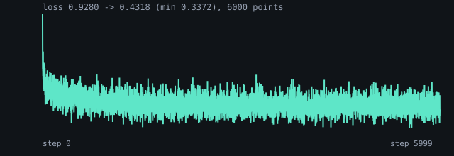
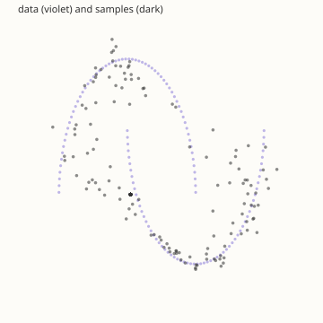

# The 2D flow: three settings, and the comparison with PyTorch

`main.bend`, two moons, 128 points, AdamW at 3e-3, full batch, 32 Euler steps. All numbers below are from runs on this
machine, recorded under `results/flow-matching/` (each variant keeps its own `run.json`, `loss.svg` and `scatter.svg`
in `variants/`). Floor: a model that predicts nothing scores **1.4665** (the data's own variance against the noise).

## The three settings

| run | hidden | lr | steps | first loss | final loss | last 100 |
|---|---|---:|---:|---:|---:|---:|
| baseline | 128 | 3e-3 | 6,000 | 1.4768 | 0.8360 | 0.8859 |
| lower lr | 128 | **1e-3** | 6,000 | 1.4768 | 0.8412 | 0.8866 |
| more steps | 128 | 3e-3 | **12,000** | 1.4768 | 0.8630 | 0.9028 |
| **wider** | **256** | 3e-3 | 6,000 | **0.9280** | **0.4318** | **0.4465** |
| wider + more steps | 256 | 3e-3 | 12,000 | 0.9280 | **0.4093** | 0.4503 |

**Width is the lever; the other two are not.** 256 wide nearly halves the loss (0.836 → 0.432), and twelve thousand
steps add little on top (final 0.409, last-100 slightly worse — the model is at its capacity). A lower learning rate
changed nothing within noise, and more steps at 128 *hurt* (0.836 → 0.863): it is not undertrained at that width, it is
too small.

The winner's scatter is the two-moons shape drawn from noise in 32 Euler steps: sample mean `[0.046, -0.104]`, std
`[0.604, 0.658]` against the data's `[0.000, 0.000]` and `[0.577, 0.659]`. The spread is right; the mean's y offset
(`-0.10`) is the visible defect.

## Against PyTorch

`reference/compare_flow2d.py` trains the same network in torch with the example's own pieces: the normalised moons, the
U32 Weyl levels, the `params()` init pattern, and the same starting cloud. It needs a venv with torch (this repository's
`reference/.venv` has none; `../bendtorch/reference/.venv` does).

**Status: the comparison does not pass yet, and the reason is a convention, not (we think) a wrong model.** Bend's
`loop` prints the loss the `Train` *carries*, i.e. the previous step's, so the first printed value is the state's
initial loss; torch's comparator records the pre-step loss. For the 256-wide run they read **0.9280 (Bend) against
1.4811 (torch)**. Two things keep this open: the first Adam step can move a full-batch loss a lot, and the 128-wide
numbers (1.4768 Bend) sit almost exactly at the torch 256 pre-step value, which is suspicious in the other direction.
Pinned in the ledger as **ISSUE-060** with the two candidate conventions, so the fix is a measurement, not a guess.
The comparator writes `results/flow-matching/compare-torch.json` either way.

## Reproduce

    BEND_LIB=$(pwd)/.bend/env bend -o .scratch/flow_bin examples/diffusion/flow_matching/main.bend
    .scratch/flow_bin                 # the winner: hidden 256, 6,000 steps, ~45 s
    reference/.venv/bin/python reference/flow_results.py <log>
    # the PyTorch side:
    ../bendtorch/reference/.venv/bin/python reference/compare_flow2d.py

The program prints its own `hidden:`/`steps:`/`euler:` now, and `flow_results.py` reads them: before 2026-11-05 it
hardcoded `hidden 128` and `steps 6000`, so a run at another configuration recorded the old one (ISSUE-059).
