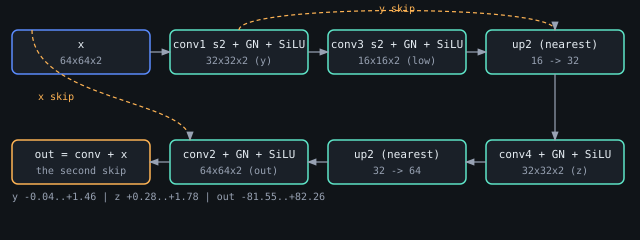
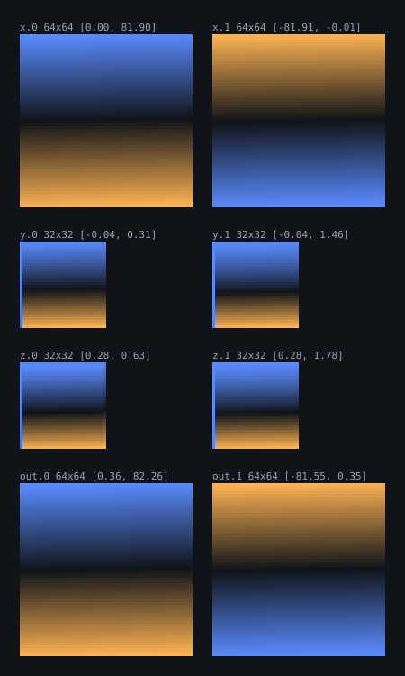
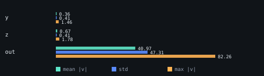

# The UNet's two levels: 64x64 to 16x16 and back

> **The trained model is `TRAINED.md`.** `model.bend` + `train.bend` train this shape on 3,874 flowers with the
> clean image as the target: 76,871 parameters, 4,000 steps, loss **0.6551 → 0.0390** against a predictor of the
> data's mean at 0.0534, and 64 draws that are **blurred flowers** — legibility **0.426** against a held-out ceiling
> of 0.562, and **0.330** on the 102 images the model never saw. The gates there are the NumPy twin **9.54e-07**, the
> torch twin **1.61e-06** and a **bit-identical** checkpoint (76,871 weights). This file records the two-level shape
> itself and its deterministic gate, which `main.bend` still checks independently of any training.

`examples/diffusion/unet/main.bend` is the smallest composition that is still a U: 64x64 -> 32x32 -> **16x16** ->
32x32 -> 64x64, two additive skips. The second level — the 32x32 stage that drops to 16x16 and comes back — was added
on 2026-11-05, and this file records it from the program's own `--dump` planes and the gates that check them.

## What the level computes

| stage | operation | shape |
|---|---|---|
| `x` | the input | 64x64x2 |
| `y` | `conv1` stride 2, `GroupNorm`, `SiLU` | 32x32x2 |
| `low` | `conv3` stride 2, `GroupNorm`, `SiLU` | 16x16x2 |
| `z` | `up2(low)`, `conv4` stride 1, `GroupNorm`, `SiLU`, `+ y` | 32x32x2 |
| `out` | `up2(z)`, `conv2` stride 1, `GroupNorm`, `SiLU`, `+ x` | 64x64x2 |

`up2` is the example's own parameterless layer: each pixel is repeated 2x2, and its backward sums the four cells that
came from one input cell, so it is an exact adjoint. Four `Conv2d` layers and four `GroupNorm` layers in all, with
`k = 3`, `p = 1`; a 32x32 image needs `hs = ws = 31` (`cimg(3, 31, 1) = 32`) and a stride of `2` is `s1 = 1`.

The pair that costs the most to get right is `y` being needed twice, once by the second level and once by its skip: a
`Mat` is linear, so `T.Mat.dup` hands both copies to a def that matches the pair.

## The planes

The weights are the example's deterministic pattern (cell `i` of every 36-cell kernel is `0.01 * i` with alternating
sign), so these are pictures of the *arithmetic*, not of a trained model: a block that computed the wrong thing shows
it as a broken plane. `x` is the signed ramp `0.01 * i`; each stage keeps a horizontal band structure, and the two
skips put the ramp back.

The scales are the honest part: `y` and `z` live around `[-0.04, 1.78]`, while `out` reaches `-81.55 .. +82.26`,
because the second skip adds the input ramp, whose cells reach +-82. That is why the whole-plane check below is a
*combined* tolerance: at |65| a float32 ulp is already `7.63e-06`.

## The gates

`reference/test_unet.py` rebuilds the whole forward in NumPy and compares the first eight cells of every stage the
program prints:

| gate | result | tolerance |
|---|---|---|
| `out`, first eight cells | **5.96e-08** | 1e-6 |
| `z`, first eight cells | **5.96e-08** | 1e-6 |
| `y`, first eight cells | **5.96e-08** | 1e-6 |
| can-fail (one cell moved by 0.5) | rejected, 0.5 | > 1e-6 |
| `up2` adjoint | PASS | exact |

`reference/compare_unet_torch.py` trains nothing; it rebuilds the same weights and forward in PyTorch and checks the
whole planes from `--dump`, which is 2,048 numbers per intermediate and 8,192 for `out`:

| plane | cells | Bend vs torch | worst cell | Bend vs NumPy |
|---|---|---|---|---|
| `y` | 2,048 | 1.19e-06 | 0.36x the allowance | 1.07e-06 |
| `z` | 2,048 | 1.19e-06 | 0.33x the allowance | 1.19e-06 |
| `out` | 8,192 | 7.63e-06 | 0.11x the allowance | 7.63e-06 |

The allowance is `2e-6 + 1e-6 * |value|` per cell: it is highest where the skip's ramp makes the value large, and no
cell exceeds it. The three pairings agree to the same order (torch against NumPy is `9.54e-07` on `y` and `z`), so the
residue is float32 accumulation, not a model difference.

The PyTorch side needs a venv with torch; this repository's has none, `bendtorch`'s does.

## One trap paid for here

The `Fwd` state type of a conv is the **im2col matrix** (output positions x `c*k*k`), not the output image. `conv4`
was first written with `MID()` as its state and the checker printed

    expected : T.Fwd<T.Lin<18n, 2n>, TA.Mat<1024n, 2n>, TA.Mat<1024n, 2n>>
    observed : T.Fwd<T.Lin<18n, 2n>, TA.Mat<1024n, 2n>, TA.Mat<1024n, 18n>>

`1024 x 18` is `1024` output positions by `2 * 3 * 3` patch cells, i.e. `CST1()`. The same rule gave `CST3()` for the
16x16 stage (`256 x 18`).

## Reproduce

    BEND_LIB=$(pwd)/.bend/env bend -o /tmp/mlbend-unet examples/diffusion/unet/main.bend
    /tmp/mlbend-unet                       # the eight-cell lines and the adjoint verdict
    /tmp/mlbend-unet --dump                # y_all, z_all, out_all: the whole planes
    reference/.venv/bin/python reference/test_unet.py
    reference/.venv/bin/python reference/unet_results.py        # run.json and the three SVGs
    ../bendtorch/reference/.venv/bin/python reference/compare_unet_torch.py

## Limits

This checks that the composition is the one the types claim and that Bend's arithmetic matches NumPy and PyTorch. It
does not train, the weights carry no signal, and two channels are small enough that the level is a building block, not
a denoiser: a real UNet at 64x64 starts at 64 channels. What is established is that the shape algebra, the im2col
order, the two group norms and the two skips all compose correctly at the second level.
