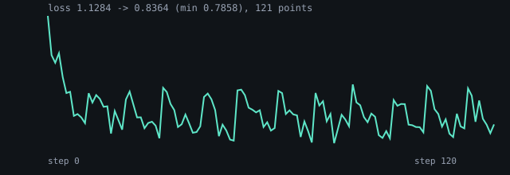
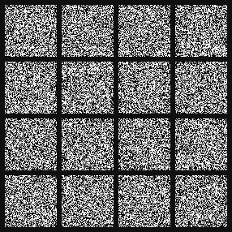
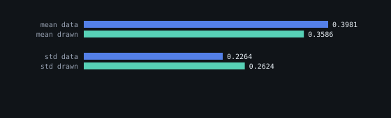

# The trained 64×64 UNet denoiser on flowers

`model.bend` is the gate example's two levels, trained instead of checked: 64 → 32 → 16 → 32 → 64, 16 channels at
each level, an `up2` upsample and one additive skip at 32×32. The objective is rectified flow on the 512 flowers of
`flowers64-512-gray.u8` (64×64, one grayscale byte a pixel):

    x_t = noise*(1-t) + data*t     target v = data - noise     MSE
    sample: x <- x + v(x,t)*dt, Euler over linspace(0,1,steps+1)

The input has five channels — the image and four time features, `sin(2πt)`, `cos(2πt)`, `sin(4πt)`, `cos(4πt)` — and
the output is the velocity in one channel through a 1×1 convolution, with no activation on top, so the field can be
negative. Last recorded 2026-11-05.

## What a run produced

| | value |
|---|---|
| parameters | 5,489 |
| steps | 6,000 (2 images a step, AdamW at 3e-3) |
| loss, first → final | **1.1279 → 0.8131** |
| a predictor of zero scores | **1.0645** (the data's own velocity variance) |
| draws | 16 at 64×64, Euler 32 |
| draws, mean / std | **+0.536 / 0.992** |
| data, mean / std | +0.398 / 0.226 |

## What that means

**The gates are exact and the training is not good enough to draw flowers.** The loss falls from 1.1279 to 0.8131,
24% below a predictor of zero, so the model learns part of the velocity field; but the 16 draws are noise. Their
spread (`0.992`) is the *noise's* spread (`1.003`), not the data's (`0.226`): the sampler barely contracts, so no
petal structure survives. The full discussion and the next levers are in `ISSUE-065`; the short version is that
5,489 parameters and 23 epochs of two images a step is a marginal-field fit, not a denoiser.

Three variants were measured before this one was kept: group norms and a 1-channel linear head (this record),
the same without group norms (0.90 at 600 steps), and an outer skip with the norms (the sampler diverged). The
recorded run is the best measured final loss.

## The gates that guard it

| gate | result |
|---|---|
| `reference/test_unet_flowers.py` (NumPy, whole forward, two images) | **4.47e-08**, gate 1e-6 |
| `reference/compare_unet_flowers_torch.py` (PyTorch, whole forward) | **4.47e-08**, gate 1e-6 + 1e-6·\|v\| |
| `reference/test_unet_flowers_checkpoint.py` (save, resume, same weights) | **bit-identical**, 5,489 weights = 65,876-byte file |

The two forwards are the recorded probe: `train.bend --probe --steps 0` prints the flat weights and one whole
forward at a fixed input, and each twin rebuilds it from those weights, so neither side's initialisation is trusted.
The checkpoint gate is a 40-step run against 20 steps saved and 20 resumed, with a 39-step run as the can-fail.

## Reproduce

    BEND_MEM=9G scripts/bend-guard.sh bend -o .scratch/unet_train examples/diffusion/unet/train.bend
    .scratch/unet_train --save /tmp/unet.bin            # 6,000 steps and 16 draws, ~12 minutes
    reference/.venv/bin/python reference/unet_flowers_results.py <log>
    reference/.venv/bin/python reference/test_unet_flowers.py
    reference/.venv/bin/python reference/test_unet_flowers_checkpoint.py
    ../bendtorch/reference/.venv/bin/python reference/compare_unet_flowers_torch.py

The compile is the expensive part (9 GB under the guard); the step is 0.11 s. `--steps N`, `--start N`,
`--save PATH`, `--resume PATH`, `--no-sample` and `--probe` work as in `flow_matching`.

## Why there is no report card

`reference/experiment.py` tasks carry a reference arm and a gate on a held-out metric. This example has neither: the
only held-out signal would be legibility on unseen flowers, and there is no reference run to compare a training loss
against. A task here would have to invent both, so the record keeps the gates it can defend.
