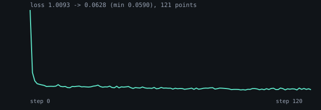
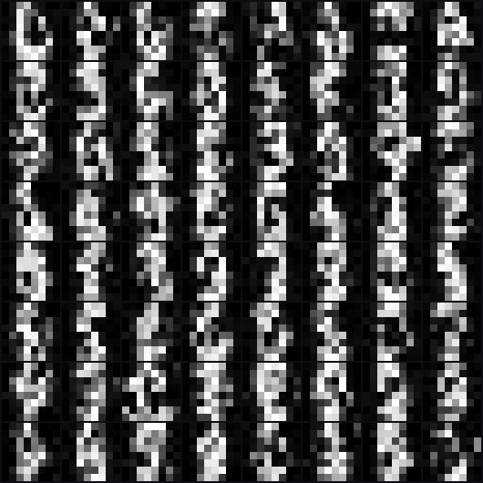

# diffusion-vit — a transformer denoiser for 8×8 digits

The same task as `examples/diffusion/digits` (noise prediction over the first
1024 optdigits rows, T = 64, the linear schedule of `mlbend-generative`, 16-step
DDIM with the clamped start), but the denoiser is a transformer instead of a
dense MLP.

    bendenv run -- bend examples/diffusion/vit/main.bend
    bendenv run -- bend examples/diffusion/vit/main.bend --steps 50 --save /tmp/vit.bend
    bendenv run -- bend examples/diffusion/vit/main.bend --steps 0 --resume /tmp/vit.bend
    ./scripts/vit.sh m1            # build + train in its own session, with a log
    ./scripts/vit.sh m1-results    # -> results/diffusion-vit/

`--steps N` trains N steps (default 3000), `--start N` numbers the first step,
`--save PATH` writes the training state and `--resume PATH` continues from it,
and `--no-samples` skips the two walks. A checkpoint carries the parameters,
AdamW's moments and `1 - b1^t` / `1 - b2^t`; it does not carry the loss, so a
`--steps 0` draw prints `final_loss: unavailable` rather than a zero.

`reference/.venv/bin/python reference/test_vit_checkpoint.py` is the gate: three
steps once, two steps plus a resume, and a zero-step draw, in about two minutes
including the build.

## The model

| | |
|---|---|
| patch | 2×2, so 16 tokens per 8×8 image |
| features | 20 per token: 4 pixels, 8 of time (`t/64 × {0.001, 0.01, 0.1, 1}` sin/cos), 8 of position |
| width | 64, one head, three blocks |
| block | `x + att(ln(x))`, then `x + mlp(ln(x))` — pre-LN, both halves |
| head | one 4-value linear per patch |
| parameters | 100,736 |
| layers | BendTorch's only: `LinearNB`, `LayerNorm`, `Attention`, `GELU`, `Residual`, `Seq` |

Three facts shaped it, all in the local issue ledger:

- **The residual must wrap the norm** (`ISSUE-010`). Written
  `Seq(ln, Residual(att))` it computes `ln(x) + att(ln(x))`, which discards the
  residual stream at every half-block; the model then trains to a plateau and
  the NumPy twin disagreed with Bend at O(1) until this was found.
- **BendTorch's `Attention` is causal** (`ISSUE-011`): query `i` reads keys
  `0..i` and the layer takes no mask. The 16 tokens are therefore attended as a
  sequence — token 0 sees only itself, token 15 sees all — and the PyTorch arm
  of the comparison runs the same mask to be the same architecture.
- **The timestep must be drawn per image, not per batch** (`ISSUE-016`). Bend
  drew one `t` for the whole minibatch while the reference draws one per image;
  on the same model and the same 3000 steps that alone was worth **+0.36**
  legibility.

Two more, about training: the ViT needs lr 3e-3 rather than the MLP's 1e-2
(`ISSUE-012`), and the minibatch must rotate through the sixteen 64-digit
chunks rather than being the same 64 digits every step (`ISSUE-013`). The
earlier chunk/timestep lock (`ISSUE-015`) had let each chunk see only 4 of the
64 timesteps; that is fixed too.

## What it measures

`run()` trains, then samples **both** ways from the one model on the one
starting cloud (`samples:` the 16-step DDIM, `samples_ddpm:` the 64-step
ancestral), and prints `data_mean`, `sample_mean`, `sample_std`. The legibility
statistic is the mean best absolute correlation of a sample with any training
digit (random images 0.326, the digits MLP 0.408, the gate 0.75).

The three arms, same data, same starting noise, same sampler step counts:

| arm | DDIM 16 | ancestral 64 | DDIM MSE | ancestral MSE |
|---|---|---|---|---|
| **Bend-ViT, 3000 steps** | **0.787** | **0.811** | 0.0598 | 0.0561 |
| torch-ViT, same architecture | 0.790 | 0.779 | 0.0583 | 0.0633 |
| lucidrains UNet, 3000 steps | 0.932 | 0.940 | 0.0202 | 0.0183 |

The Bend model is within 0.003 of the PyTorch twin on DDIM and ahead of it on
the ancestral sampler. Its cloud is mean/std **+0.2957 / 0.3395** against the
data's **+0.3076 / 0.3767**, with 4087 of 4096 pixels in `[0, 1]`. The UNet is
still the better denoiser on 8×8 digits — it has the convolutions and the
group norms that this model does not.

The card is `results/diffusion-vit/REPORT.md`; the three-arm page is
`results/compare/index.html`.

