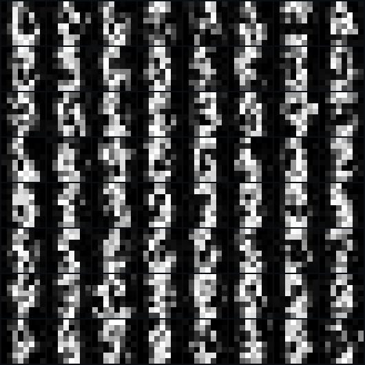
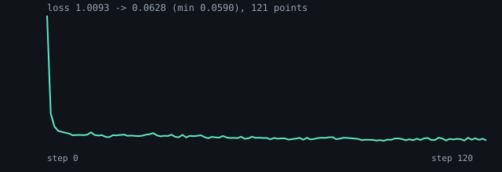

# The ViT denoiser: what it produces

`main.bend` trains a small ViT denoiser on the first 1,024 optdigits and samples it two ways. Everything below is from
the recorded run (`results/diffusion-vit/run.json`) and the gates that re-check it (`reference/test_diffusion_vit.py`).
Last recorded 2026-11-05, after the level fix (ISSUE-040).

## The pictures

**64 samples, DDIM (16 steps), 8x8 grid** — each cell is one 8x8 digit the model drew from noise:

**The training loss** — 121 printed points:

What the grid shows, plainly: most cells read as a digit — `0`, `3`, `8`, `5`, `6` — with clean strokes and dark
background. A few cells are blobs, and the cells are *very* small: a sample is 8x8 pixels, because the model works on
2x2 patches of an 8x8 image (16 tokens of 4 pixels), and the grid upscales them. That is the resolution ceiling, not a
training failure: a training digit is also 8x8.

## The numbers

| | value |
|---|---|
| loss, first -> last | 1.0093 -> 0.0628 (minimum 0.0590, 121 points) |
| DDIM samples (16 steps) | legibility **0.7955**, nearest-digit MSE **0.0576** |
| DDPM samples (64 steps) | legibility **0.8070**, nearest-digit MSE **0.0571** |
| legibility range | 0.648 to 0.898 over the 64 samples |
| parameters | 100,736 |

Legibility is the mean best absolute correlation of each sample with any training digit. For scale: random images score
**0.326**, the dense MLP **0.408**, torch's causal ViT **0.774**, torch's bidirectional ViT **0.809**, the reference UNet
**0.926**. At 0.7955 (DDIM) and 0.807 (DDPM) this ViT is above the PyTorch twin of its own architecture and level with
the bidirectional one.

## The gates that say those numbers are real

`reference/test_diffusion_vit.py`, all passing on the committed record:

| gate | result |
|---|---|
| first loss against the twin | 1.0093014 vs 1.0093014, **delta 2.40e-08** (tol 1e-5) |
| forward (frozen weights) | 1.19e-07 |
| one ancestral step | 4.77e-07 |
| 16-step DDIM cloud | 6.38e-06 |
| `eta = 0` invariance | 0 (a draw of noise moves the cloud by nothing) |
| legibility | 0.795, gate 0.75 |

The last one is the visual claim made numeric: the samples must be digit-like, not merely low-loss.

## Reproduce it

    BEND_MEM=9G scripts/bend-guard.sh bend -o /tmp/vit_bin examples/diffusion/vit/main.bend
    /tmp/vit_bin > /tmp/vit_ln.txt              # ~20 minutes, 3,000 steps
    reference/.venv/bin/python reference/vit_results.py /tmp/vit_ln.txt
    reference/.venv/bin/python reference/test_diffusion_vit.py

A plain `bend examples/diffusion/vit/main.bend` dies with `machine stack overflow`; the guarded build is required.

## Known gap: no checkpoint

The example saves no trained weights, so **the samples above cannot be regenerated without the 20-minute retrain** —
`examples/diffusion/flow_matching` has `--save`/`--resume` and this one does not (ISSUE-058). Until it does, the grid in
`results/diffusion-vit/` is the only picture of this model.
